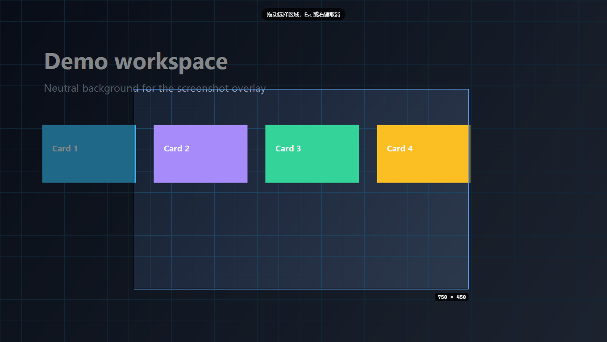
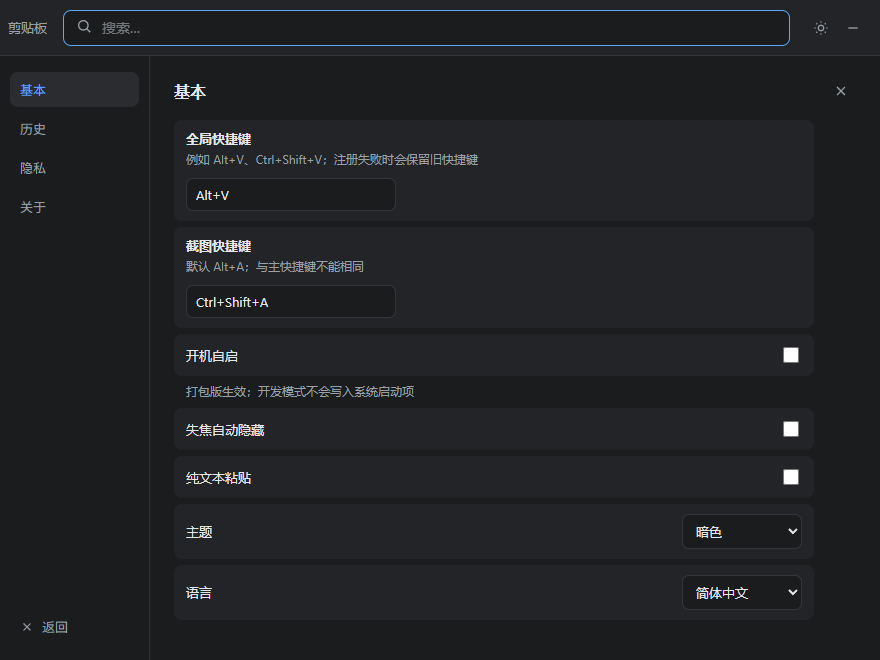

# uClipboard

跨平台开源剪贴板管理器，基于 Tauri 2 + React + TypeScript。

当前进度：**M1 + M2 + M3 功能完成，v0.1.0 待发布**。真实剪贴板采集、SQLite 持久化、搜索/收藏/置顶/删除/复制、自动粘贴、全局快捷键、托盘、单实例、开机自启、忽略应用、隐私标记识别、临时中转窗口、区域截图、快捷键按键录制、设置持久化、中英文和自动更新均已接入。Windows 真机完成功能验证；macOS/Linux 构建配置已加入 CI，仍需真机验收。

## 截图

<p align="center"></p>
<p align="center"></p>
<p align="center">
  
  
</p>

## 功能

### 剪贴板历史

- 文本 / 图片 / 文件三类采集；文件优先于图片，图片优先于文本
- 图片原图落盘、300px 缩略图、原图预览
- SQLite 持久化；同一内容去重并移动到顶部
- 搜索、收藏、置顶、删除、清空；清空或删除时同步清理图片文件
- 历史上限、保留天数、三类采集开关、最短文本长度、暂停监控
- 富文本 HTML 相关格式随文本保存；复制时写回原格式，可切换纯文本粘贴
- 自动识别 Windows 隐私剪贴板格式和 macOS Concealed/Transient/AutoGenerated 标记
- 按进程名忽略密码管理器等应用，设置页提供建议名单

### 快捷操作

- 双击 / Enter 粘贴并隐藏主窗口；中转窗口双击保持自身可见
- `Alt+V` 切换显示/隐藏；最小化后按快捷键恢复；窗口在鼠标所在显示器居中
- `Alt+A` 区域截图：拖动选区松开即写入剪贴板，`Esc` 或右键取消；截图快捷键可配置，被占用时自动回退到 `Ctrl+Shift+A`
- 区域截图写入剪贴板后会作为图片条目进入历史（暂停监控时只写入剪贴板）
- 数字键 `1-9` 直接粘贴对应条目
- `Esc` 逐级关闭预览、清空搜索、隐藏窗口
- 主窗口不显示任务栏图标，关闭按钮改为隐藏，托盘常驻
- 托盘菜单：显示、暂停/恢复监控、清空历史、设置、退出
- 第二实例启动时唤起已有窗口

### 临时中转

- 单击条目即多选；右栏按钮打开独立置顶小窗
- 支持搜索、复制全部、收藏全部、关闭
- 多条文本按换行合并，文件合并为文件列表，多张图片纵向拼接为一张图片
- 双击卡片优先把焦点还给目标窗口后发送粘贴键，避免中转窗闪烁

### 设置与体验

- 设置持久化到 `config.json`；支持快捷键改绑、开机自启、失焦隐藏、纯文本粘贴
- 快捷键改为按键录制：点击后直接按组合键并自动保存；录制期间暂停 uClipboard 自己的全局快捷键，10 秒无操作自动退出
- 主题：跟随系统 / 亮色 / 暗色；语言：跟随系统 / 简体中文 / English
- 启动时及每 24 小时检查更新，设置页可手动检查并安装
- 关于页显示版本与许可证

## 开发（Windows）

前置环境：Node.js、Rust（stable-msvc）、Visual Studio Build Tools（C++ 桌面开发工作负载）、WebView2 Runtime。

```bat
scripts\check.cmd   :: cargo check
scripts\test.cmd    :: cargo test
scripts\dev.cmd     :: npm run tauri dev
```

说明：Git Bash 自带的 `link.exe` 会抢占 MSVC 链接器，脚本会先加载 `vcvars64.bat` 再执行命令。GitHub Actions 使用原生环境，不需要这个包装。

数据位置：`%APPDATA%\com.uclipboard.app\`，包含 `uclipboard.db`、`config.json` 和 `images/`。数据未加密，敏感内容请使用忽略名单或系统隐私标记。

## 打包与发布

```bash
npm run build
npm run tauri build
```

基础配置默认不生成更新签名产物，本地打包不需要私钥。发布时使用 `src-tauri/tauri.updater.conf.json` 覆盖配置：

```bash
npm run tauri build -- --config src-tauri/tauri.updater.conf.json
```

需要在环境中提供：

- `TAURI_SIGNING_PRIVATE_KEY`：更新签名私钥
- `TAURI_SIGNING_PRIVATE_KEY_PASSWORD`：私钥密码，可为空

公钥已写入 `src-tauri/tauri.conf.json` 的 `plugins.updater.pubkey`。更新端点在 `plugins.updater.endpoints`，如仓库地址变化需同步修改。推送到 `v*` tag 会触发 `.github/workflows/release.yml` 创建草稿 Release；普通分支和 PR 由 `.github/workflows/ci.yml` 在三平台运行前端构建与 Rust 单测。

Linux 构建需要 `libwebkit2gtk-4.1-dev`、`libappindicator3-dev`、`librsvg2-dev`、`patchelf`。macOS 自动粘贴需要授予辅助功能权限；Wayland 下模拟粘贴可能不可用，失败时降级为仅复制。

## M0 静态原型

`prototypes/` 保留 M0 的静态 HTML 原型，用于设计预览：

```bash
node prototypes/serve.js
```

打开 http://localhost:4173 。可选参数：`?theme=light`、`?theme=dark`、`?tab=favorite`、`?settings=1`。

## 已知限制

- 多条图片合并为纵向拼接；图片暂不能与文本/文件混排合并
- 中转窗暂不支持逐条移除或拖拽排序
- 临时中转的焦点恢复优化仅在 Windows 启用，其他平台回退为隐藏/重开
- 区域截图只在 Windows 完成真机验收；macOS 需要屏幕录制权限，Wayland 的覆盖层定位取决于桌面环境
- 录制快捷键时无法屏蔽其它软件已注册的全局热键；被占用的组合请换一个或临时关闭对应软件
- macOS/Linux 已进入 CI 构建，但本版本只在 Windows 真机完成完整交互验收
- 代码签名/公证不在 v1 范围，Windows SmartScreen 与 macOS Gatekeeper 可能提示

## 文档

- 设计文档：`docs/superpowers/specs/2026-11-20-uclipboard-design.md`
- 区域截图设计：`docs/superpowers/specs/2026-11-23-region-screenshot-design.md`
- 区域截图计划：`docs/superpowers/plans/2026-11-23-region-screenshot.md`
- M0 验收：`docs/superpowers/plans/2026-11-20-uclipboard-m0-acceptance.md`
- M1 验收：`docs/superpowers/plans/2026-11-20-uclipboard-m1-acceptance.md`
- M2 粘贴增量验收：`docs/superpowers/plans/2026-11-20-uclipboard-m2-paste-acceptance.md`
- M2 临时中转验收：`docs/superpowers/plans/2026-11-20-uclipboard-m2-transfer-acceptance.md`
- M2/M3 增量验收：`docs/superpowers/plans/2026-11-20-uclipboard-m2-m3-acceptance.md`

## 许可证

Apache-2.0。第三方图标声明见 `NOTICE`。

uClipboard 是独立开源项目，与任何第三方启动器或剪贴板产品无关联。
