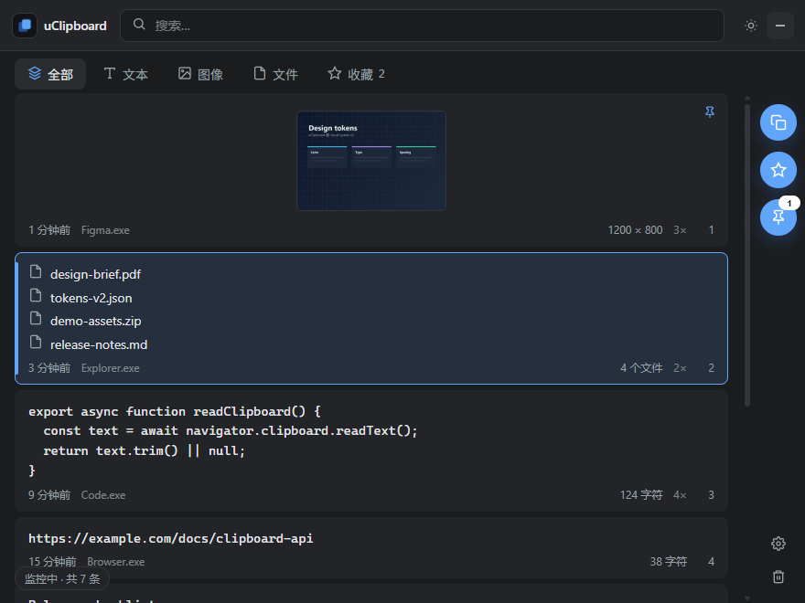
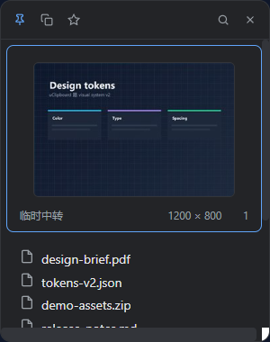

<p align="center"></p>

# uClipboard

一个轻量、开源的剪贴板管理器：自动记录文本、图片和文件，支持搜索、收藏、置顶、区域截图和快速粘贴。数据只保存在本机。

<p align="center"></p>
<p align="center"></p>
<p align="center">
  
  
</p>

## 功能

- **剪贴板历史**：自动记录文本、图片和文件，重复内容去重并置顶
- **快速搜索**：按内容搜索，收藏和置顶条目不会被历史清理
- **区域截图**：快捷键唤起覆盖层，拖选后直接写入剪贴板
- **快速粘贴**：双击或回车粘贴，支持数字键直接粘贴前 9 条
- **临时中转**：多选后打开独立小窗，支持复制全部、收藏全部和逐条粘贴
- **隐私保护**：识别系统隐私剪贴板标记，可按进程名忽略密码管理器
- **个性化**：亮/暗主题、跟随系统、中英文、可配置全局快捷键
- **数据本地化**：SQLite + 本地图片文件，不上传任何内容

## 下载

从 [GitHub Releases](https://github.com/pigstrong9/uClipboard/releases) 下载 Windows 安装包。首发版本暂不提供 macOS 安装包。

安装包未做代码签名，Windows SmartScreen 可能提示；选择“仍要运行”即可。

## 使用

| 操作 | 快捷键 |
| --- | --- |
| 显示/隐藏主窗口 | `Alt+V` |
| 区域截图 | `Alt+A`（被占用时回退 `Ctrl+Shift+A`） |
| 粘贴选中项 | `Enter` 或双击 |
| 直接粘贴前 9 条 | `1` – `9` |
| 收藏 / 置顶 | `Ctrl+D` / `Ctrl+P` |
| 删除 | `Delete` |
| 预览全文/图片 | `Space` |
| 关闭预览/搜索/窗口 | `Esc` |
| 搜索 | `/` 或直接输入字母 |

首次使用区域截图时，需要允许系统屏幕录制权限；自动粘贴需要辅助功能权限。

## 隐私

- 历史、配置和图片都保存在本机 `%APPDATA%\com.uclipboard.app\`
- 数据默认不加密；敏感内容请使用忽略名单或系统隐私剪贴板标记
- 设置里可以随时暂停监控、清空历史或忽略指定应用

## 从源码构建

Windows 需要 Node.js、Rust stable-msvc、Visual Studio Build Tools（C++ 桌面开发工作负载）和 WebView2 Runtime。

```bat
scripts\check.cmd   :: cargo check
scripts\test.cmd    :: cargo test
scripts\dev.cmd     :: npm run tauri dev
```

打包：

```bash
npm run tauri build
```

GitHub Actions 会在 Windows 和 Linux 上构建；macOS 目前保留编译检查，但首发不提供安装包。

## 已知限制

- Windows 已完成完整交互验收；Linux 需要真机验证，Wayland 下覆盖层定位和模拟粘贴可能受桌面环境限制
- 区域截图要求 macOS 屏幕录制权限；自动粘贴要求辅助功能权限
- 录制快捷键时无法屏蔽其它软件已注册的全局热键；被占用的组合请换一个或临时关闭对应软件
- 多条图片合并为纵向拼接；图片暂不能与文本/文件混排合并
- 中转窗暂不支持逐条移除或拖拽排序
- 未做代码签名/公证；Windows SmartScreen 与 macOS Gatekeeper 可能提示

## 许可证

Apache-2.0。第三方图标声明见 [NOTICE](NOTICE)。

uClipboard 是独立开源项目，与任何第三方启动器或剪贴板产品无关联。
